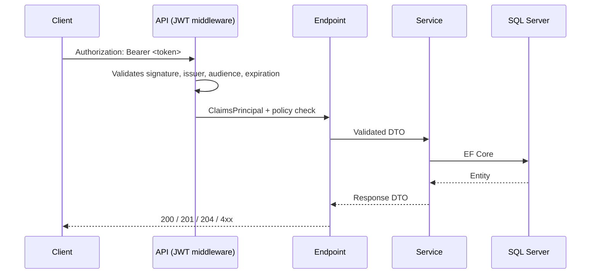
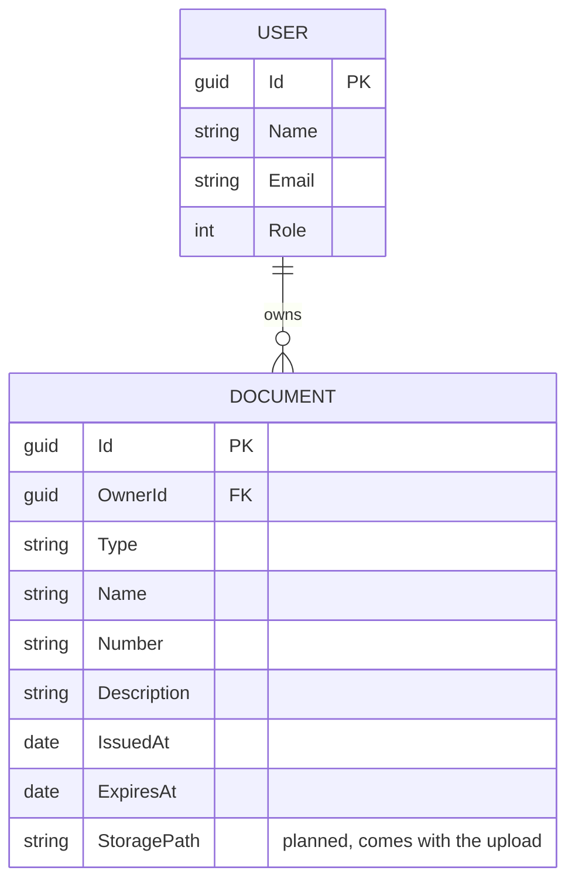

# Authdoc

**A personal document vault: everything organized in one place, ready when it is asked for.**

An application for **organizing and storing personal documents**. Today, what exists is the foundation: an identity and access control API built with **ASP.NET Core 10 (Minimal APIs)**, **JWT**, **Entity Framework Core** and **SQL Server**.

---

## The problem

In August 2026 I went to my immigration appointment in Portugal with every document on the official published list, all of them valid. At the counter, I was told that documents were missing, and those documents were not on that list.

It is not possible to predict everything that may be asked for. What I can control is having every document I own stored, organized and with its expiry date in plain sight. That is how Authdoc was born.

## Product vision

Authdoc is a personal vault: each person keeps their own documents in one place, organized by type, and can find them at the moment they are asked for.

- **Organization:** each document has a type, a number, an issue date and an expiry date
- **Private storage:** upload and access are restricted to the owner
- **Deadline in plain sight:** each document shows a status calculated from the expiry date entered by the user: `Valid`, `ExpiringSoon` (expires within 30 days) or `Expired`

The central guarantee of the project:

> **Each user accesses only their own documents.**

This rule has no exception: the `Admin` role manages accounts, but it does not give access to other users' documents.

That is why the project starts with the identity layer. Authentication, roles and token issuing are the foundation on which the documents module is being built.

### What Authdoc is not

- **It does not say which documents a process requires.** It stores what the user has, not what an institution may ask for.
- **It does not validate documents.** "Within the deadline" only means that the expiry date entered has not passed yet. The application does not check authenticity or whether the document will be accepted.
- **It does not report anyone's legal status and it is not legal advice.**
- **It is not a production service.** It is a portfolio project, with no public environment, and it must not receive real documents from third parties.

## Current status

| Module | Status |
|---|---|
| Authentication (login, JWT issuing) | ✅ Implemented |
| Session (refresh token with rotation and revocation) | ✅ Implemented |
| Password change | ✅ Implemented |
| Role-based authorization (`Admin` / `User`) | ✅ Implemented |
| User management (administrative CRUD and pagination) | ✅ Implemented |
| Rate limiting on login, password change and refresh | ✅ Implemented |
| Global exception handling | ✅ Implemented |
| Automatic bootstrap (migrations + initial admin) | ✅ Implemented |
| Unit and integration tests | ✅ Implemented |
| CI pipeline (build and tests) | ✅ Implemented |
| Automatic deploy to Azure App Service | ⏸️ Configured, turned off until a production environment exists |
| **Documents module** | 🚧 In development |
| Document data (create, list, read, update and delete) | ✅ Implemented |
| Document ↔ user link with ownership-based authorization | ✅ Implemented |
| Validity status (`Valid` / `ExpiringSoon` / `Expired`) | 🚧 In development |
| Expiry notification (Workers + Outbox) | 📋 Planned |
| Public sign-up (self-registration) | 📋 Planned |

Today Authdoc is an **identity and user management API** in which each user can also register, list, read, update and delete the data of their own documents. The validity status and the file upload are still missing (see the [Roadmap](#roadmap)). The documents module reuses all the authentication infrastructure that already exists.

---

## Stack

| Layer | Technology |
|---|---|
| Runtime | .NET 10 |
| Web | ASP.NET Core Minimal APIs |
| Persistence | Entity Framework Core 10 + SQL Server |
| Authentication | JWT Bearer (`Microsoft.AspNetCore.Authentication.JwtBearer`) |
| Password hashing | `IPasswordHasher<T>` from ASP.NET Core Identity (PBKDF2) |
| Documentation | OpenAPI + [Scalar](https://scalar.com) |
| Tests | xUnit + `WebApplicationFactory` + EF Core InMemory |
| CI/CD | Azure Pipelines + Azure App Service |

## Concepts and fundamentals applied

- **Stateless authentication with JWT:** the token is signed with HMAC-SHA256 and carries identity claims (`NameIdentifier`, `Name`, `Email`, `Role`). The API validates issuer, audience, lifetime and signature on every request.
- **Refresh token with rotation:** each use generates a new token and revokes the previous one. Only the SHA-256 hash is stored in the database.
- **Role-based access control (RBAC):** an `Admin` policy protects the administrative routes.
- **Salted password hashing:** passwords are never stored in plain text. The `PasswordHasher` generates PBKDF2 hashes with a random salt and format versioning, which allows a rehash when the algorithm evolves.
- **Dependency injection and service lifetime:** services and the `DbContext` are registered as *Scoped* (one per request). At startup, an explicit scope is created for the database bootstrap.
- **Code-first with EF Core Migrations:** the schema is versioned in code and applied automatically at startup.
- **Layer separation:** endpoints (HTTP) → services (business rules) → `DbContext` (persistence), with DTOs isolating the API contract from the domain model.
- **Resource-based authorization:** every document query is filtered by the owner id taken from the token, and another user's document answers `404`, so its existence is never revealed.
- **GUID identifiers:** they prevent sequential enumeration of resources, which matters when the resources are personal documents.
- **HTTP semantics:** `201 Created` with `Location`, `204 No Content` and `409 Conflict` for a duplicate email.

---

## Architecture

```
├── azure-pipelines.yml            # CI/CD pipeline
├── Authdoc/
│   ├── Program.cs                 # Composition: DI, JWT, policies, rate limiting, bootstrap, HTTP pipeline
│   └── Src/
│       ├── Endpoints/             # HTTP mapping (Minimal API) and input validation
│       ├── Application/
│       │   ├── DTOs/              # Request/response contracts
│       │   └── Services/          # AuthService, UserService, DocumentService (business rules)
│       ├── Data/
│       │   ├── ManagerDbContext.cs  # DbContext and model configuration
│       │   ├── DbInitializer.cs     # Migrations + initial admin seed
│       │   └── Migrations/
│       ├── Models/Entities/       # Domain entities (User, UserRole, RefreshToken, Document)
│       ├── Responses/             # Error format and global exception handling
│       └── Validators/            # Email validation
└── Authdoc.Tests/
    ├── Integration/               # Full API over HTTP
    └── *.cs                       # Unit tests
```

Flow of an authenticated request:



---

## How to run

### Prerequisites

- [.NET SDK 10](https://dotnet.microsoft.com/download)
- SQL Server (the default configuration points to `localhost\SQLEXPRESS` with Windows integrated authentication)
- Optional: `dotnet tool install --global dotnet-ef`, to manage migrations

### Configuration

The non-sensitive settings are in `Authdoc/appsettings.json`:

```json
{
  "ConnectionStrings": {
    "DefaultConnection": "Server=localhost\\SQLEXPRESS;Database=Authdoc;Trusted_Connection=True;TrustServerCertificate=True;"
  },
  "Jwt": {
    "Issuer": "Authdoc",
    "Audience": "Users",
    "ExpirationInMinutes": 60,
    "RefreshTokenExpirationInDays": 7
  },
  "RateLimiting": {
    "LoginPermitLimit": 5,
    "RefreshPermitLimit": 30
  }
}
```

In development, the secrets come from User Secrets. Outside development, the API needs these environment variables:

| Setting | Environment variable | Required |
|---|---|---|
| JWT signing key | `Jwt__Key` | Always |
| Initial admin password | `SeedData__AdminPassword` | While the initial admin does not exist |
| Database connection string | `ConnectionStrings__DefaultConnection` | Always, because the default value only works on the local machine |

### JWT signing key

The signing key is a secret, so it is **not** in `appsettings.json`. The API reads the value of `Jwt:Key`, which must have at least 32 bytes (HS256); with less than that, the API does not start. Generate a random key once and store it in [User Secrets](https://learn.microsoft.com/aspnet/core/security/app-secrets), which stay outside the repository:

```powershell
cd Authdoc

# PowerShell
$bytes = New-Object byte[] 64
[System.Security.Cryptography.RandomNumberGenerator]::Create().GetBytes($bytes)
dotnet user-secrets set "Jwt:Key" ([Convert]::ToBase64String($bytes))
```

```bash
# Bash
dotnet user-secrets set "Jwt:Key" "$(openssl rand -base64 64 | tr -d '\n')"
```

### Initial admin password

The initial admin password is also a secret. Choose a strong password and store it in `SeedData:AdminPassword`:

```powershell
cd Authdoc
dotnet user-secrets set "SeedData:AdminPassword" "<your-strong-password>"
```

It is only needed when the initial admin is created (see [Bootstrap](#bootstrap-the-first-user)). If the admin does not exist yet and the setting is missing, the API fails at startup.

### Starting the API

```bash
git clone <repository-url>
cd Authdoc
dotnet run --project Authdoc
```

- API: `http://localhost:5297`
- Interactive documentation (Scalar, only in `Development`): `http://localhost:5297/scalar`

### Running the tests

```bash
dotnet test
```

| Type | What it covers |
|---|---|
| Unit | `EmailValidator`, the `UserService` rules (last admin, deletion, role change) and the `DocumentService` rules (each operation only reaches the owner's own documents) |
| Integration | The whole API over HTTP with `WebApplicationFactory`: authentication, refresh token, password change, users, documents (including `404` for another user's document), pagination, rate limiting and error codes |

The tests use an **in-memory** database and their own configuration, so they do not need SQL Server or User Secrets.

---

## CI/CD

The pipeline is in `azure-pipelines.yml` and runs on every change to the `main` branch:

1. Restores the dependencies
2. Builds in `Release`
3. Runs the tests; if any test fails, the deploy does not happen
4. Publishes the API and generates the `drop` artifact
5. Deploys to Azure App Service, only on `main` and with the `deployEnabled` variable set to `'true'`

The deploy is turned off (`deployEnabled: 'false'`) until the production database and settings exist. The other steps keep running.

---

## How I use AI in the project

I use AI agents in the development, with fixed rules:

- Branches, code and commits follow a standard defined by me, applied by skills and subagents dedicated to specific tasks
- Every change is reviewed by me before the merge
- I also use AI to study the concepts behind what was generated: the goal is to be able to explain every decision described in this README

---

## Bootstrap: the first user

Registering users is an **administrative** operation: the register endpoint requires the `Admin` policy. This creates a classic "chicken and egg" problem: without an admin, nobody can register anybody.

The `DbInitializer` solves this when the application starts:

1. **Applies the pending migrations** (`Database.MigrateAsync()`). The database is created if it does not exist yet.
2. **Checks whether any user with the `Admin` role already exists.** If one exists, it does nothing. The operation is idempotent and safe to run at every startup.
3. **If a user with the default admin email exists, but without the role**, it promotes that user to `Admin`.
4. **Otherwise, it creates the initial admin**, with the password going through the same `IPasswordHasher` used in the register and login flow.

Initial credentials:

| Email | Password |
|---|---|
| `admin@system.com` | The value configured in `SeedData:AdminPassword` (see [Initial admin password](#initial-admin-password)) |

### First complete flow

```http
### 1. Log in as admin
POST http://localhost:5297/api/auth/login
Content-Type: application/json

{ "email": "admin@system.com", "password": "<SeedData:AdminPassword>" }

### 2. Register a user (use the token returned in step 1)
POST http://localhost:5297/api/auth/register
Authorization: Bearer <token>
Content-Type: application/json

{
  "name": "Maria Silva",
  "email": "maria@gmail.com",
  "password": "password123",
  "confirmationPassword": "password123"
}

### 3. Log in with the new user
POST http://localhost:5297/api/auth/login
Content-Type: application/json

{ "email": "maria@gmail.com", "password": "password123" }
```

---

## Endpoints

### Auth

| Method | Route | Access | Description |
|---|---|---|---|
| `POST` | `/api/auth/login` | Public | Authenticates and returns the JWT, the refresh token, the expirations and the user data |
| `POST` | `/api/auth/refresh` | Public | Exchanges a valid refresh token for a new pair of tokens |
| `PUT` | `/api/auth/password` | Authenticated | Changes the user's own password (ends the other sessions) |
| `POST` | `/api/auth/register` | Admin | Registers a new user |
| `GET` | `/api/auth/me` | Authenticated | Returns the identity inside the token, including the role |

### Users

| Method | Route | Access | Description |
|---|---|---|---|
| `GET` | `/api/users?page=1&pageSize=10` | Admin | Lists users with pagination (`pageSize` from 1 to 100) |
| `GET` | `/api/users/{id}` | Admin | Returns one user |
| `PUT` | `/api/users/{id}` | Admin | Updates name and email |
| `PATCH` | `/api/users/{id}/role` | Admin | Changes the user's role (`Admin` or `User`) |
| `DELETE` | `/api/users/{id}` | Admin | Removes a user |

### Documents

Every route acts only on the documents of the user in the token. The `Admin` role gives no extra access here.

| Method | Route | Access | Description |
|---|---|---|---|
| `POST` | `/api/documents` | Authenticated | Registers a document and returns `201` with `Location` |
| `GET` | `/api/documents?page=1&pageSize=10` | Authenticated | Lists the user's own documents with pagination (`pageSize` from 1 to 100) |
| `GET` | `/api/documents/{id}` | Authenticated | Returns one document |
| `PUT` | `/api/documents/{id}` | Authenticated | Updates a document |
| `DELETE` | `/api/documents/{id}` | Authenticated | Removes a document |

Request body for `POST` and `PUT`:

```json
{
  "type": "Passport",
  "name": "My passport",
  "number": "FZ123456",
  "description": "Brazilian passport",
  "issuedAt": "2024-01-10",
  "expiresAt": "2034-01-10"
}
```

### Business rules

- The email must be valid, from any domain, and unique in the database; it is validated on registration and on update
- The email is normalized (trimmed and lowercased) before validating, searching or saving
- The name is required, with at most 100 characters
- The password has at least 8 characters, cannot be only spaces, and is confirmed on registration
- Login and password change are limited to 5 attempts per minute per IP, and refresh to 30; above that the API responds with `429`
- The refresh token is valid for 7 days, can be used only once (each use generates a new one) and is stored only as a SHA-256 hash
- Changing the password revokes all the user's refresh tokens
- The role cannot be changed through the update endpoint, which prevents privilege escalation through the payload
- The role is changed only through `PATCH /api/users/{id}/role`, with the body `{ "role": "Admin" }` or `{ "role": "User" }`
- A role change takes effect on the next refresh or login, because the role is stored in the JWT
- An admin cannot change their own role, and the last admin of the system cannot be demoted
- An admin cannot delete their own user, and the last admin of the system cannot be deleted
- A document belongs to the user in the token; an owner id sent in the request body is ignored
- Reading, updating or deleting a document of another user returns `404`, the same answer as for a document that does not exist
- Document type and number are required, with at most 50 characters each; the name is required, with at most 100; the description is optional, with at most 500
- Document text fields are trimmed before validating and saving, and a blank description is saved as empty
- The issue date is required and cannot be in the future (one day of tolerance covers clients ahead of UTC)
- The expiry date is optional; when sent, it must be after the issue date. A document that has already expired can be registered
- Unexpected exceptions are intercepted and logged in one central place by the `IExceptionHandler`, without exposing internal details to the client

### Error format

The API error responses have the same format, with a stable `code` (for the client to handle) and a readable `message`:

```json
{ "code": "EMAIL_INVALID", "message": "Email is invalid" }
```

| Status | Codes |
|---|---|
| `400` | `INVALID_REQUEST`, `NAME_REQUIRED`, `NAME_TOO_LONG`, `EMAIL_REQUIRED`, `EMAIL_INVALID`, `PASSWORD_REQUIRED`, `PASSWORD_TOO_SHORT`, `PASSWORDS_DO_NOT_MATCH`, `ROLE_INVALID`, `CANNOT_CHANGE_OWN_ROLE`, `CANNOT_DELETE_OWN_USER`, `CURRENT_PASSWORD_REQUIRED`, `CURRENT_PASSWORD_INCORRECT`, `NEW_PASSWORD_SAME_AS_CURRENT`, `REFRESH_TOKEN_REQUIRED`, `PAGE_INVALID`, `PAGE_SIZE_INVALID`, `TYPE_REQUIRED`, `TYPE_TOO_LONG`, `NUMBER_REQUIRED`, `NUMBER_TOO_LONG`, `DESCRIPTION_TOO_LONG`, `ISSUED_AT_REQUIRED`, `ISSUED_AT_IN_FUTURE`, `EXPIRES_AT_BEFORE_ISSUED_AT` |
| `401` | `INVALID_CREDENTIALS`, `INVALID_REFRESH_TOKEN`, `UNAUTHORIZED` |
| `403` | `FORBIDDEN` |
| `404` | `USER_NOT_FOUND`, `DOCUMENT_NOT_FOUND` |
| `409` | `EMAIL_ALREADY_IN_USE`, `LAST_ADMIN` |
| `429` | `TOO_MANY_REQUESTS` |
| `500` | `INTERNAL_ERROR` |

The codes are centralized in `Src/Responses/ApiErrors.cs`.

---

## Roadmap

### In development: documents module

The goal is to link each document to its owner in the database and apply **resource-based authorization**: besides being authenticated, the user only reads, changes or removes documents that belong to them.



Module rules:

- `Document` entity with the foreign key `OwnerId → User.Id`; deleting a user deletes their documents
- The `OwnerId` always comes from the `NameIdentifier` claim of the token, never from the request body
- Queries are filtered by owner (`WHERE OwnerId = @currentUser`), with `404` for other users' documents, without revealing that they exist
- The `Admin` role does not give access to other users' documents
- File storage behind an interface, with a local disk implementation, so the API does not depend on the physical location
- Upload restricted to PDF, JPG and PNG, with at most 10 MB
- Validity status calculated from `ExpiresAt`: `Valid`, `ExpiringSoon` (expires within 30 days) or `Expired`
- A document without an expiry date is always `Valid`

Validity status rule:

| `ExpiresAt` | Status |
|---|---|
| Not set | `Valid` |
| More than 30 days from today | `Valid` |
| Today or within the next 30 days | `ExpiringSoon` |
| Before today | `Expired` |

The status is only returned when the document is read. No notification is sent in this stage.

Progress:

| Step | Status |
|---|---|
| `Document` entity, `Documents` table and relation to `User` | ✅ Done |
| Request and response DTOs | ✅ Done |
| `DocumentService` (create, list, get, update and delete, always filtered by owner) with unit tests | ✅ Done |
| HTTP routes with input validation (see [Documents](#documents)) | ✅ Done |
| Integration tests for the routes | ✅ Done |
| Validity status | 📋 To do |
| File upload and storage | 📋 To do |

Definition of done for the module:

1. Send a document (file, type, number, issue date and expiry date)
2. List and read only the user's own documents
3. Reading, changing or removing another user's document returns `404`
4. Each document returned carries the validity status
5. Integration tests for points 2 and 3 and unit tests for the status rule

### Later

- **Public sign-up:** today registration is an administrative operation (see [Bootstrap](#bootstrap-the-first-user)), so a person cannot create their own account yet
- **Expiry notification:** actively warn the user, with Workers and Outbox. In this stage the deadline appears only as a status when the document is read

### Open question

A point that needs a decision before any real use:

| Question | Why it matters |
|---|---|
| Sensitive personal data (GDPR) | Passports and residence permits require encryption at rest, a retention policy and deletion at the request of the data subject |

### Base evolution

- [x] Resource-based authorization for documents (owner filter in `DocumentService`)
- [ ] Centralized validation (FluentValidation)
- [ ] Docker Compose (API + SQL Server)
- [x] Build and test pipeline (deploy configured, turned off)
- [x] Unique email index and length limits on `Email` and `Name`
- [x] Global exception handling
- [x] Refresh token and session revocation
- [x] Rate limiting on login
- [x] Paginated user list
- [x] Secrets through User Secrets / environment variables
- [x] Unit and integration tests (xUnit + `WebApplicationFactory`)

---

## Security

The JWT key and the initial admin password are not versioned: in development they come from User Secrets and, in the other environments, from environment variables (see [Configuration](#configuration)). In any real environment, the admin password must be changed on the first access.

### Known limitations

| Limitation | Impact | Possible solution |
|---|---|---|
| The JWT stays valid until it expires | A demoted or deleted user keeps the old access for up to `Jwt:ExpirationInMinutes`. The refresh already returns the new role, but the old token stays valid until it expires | Reduce `Jwt:ExpirationInMinutes` (the refresh avoids repeated logins) or check a *security stamp* on every request |
| The last admin rule is not atomic | Two simultaneous requests can demote or delete the last two admins | A transaction with the right isolation level or a database lock |
| Rate limiting is in memory and per IP | It resets when the API restarts, it is not shared between instances and, behind a proxy, everyone can look like the same IP | Distributed rate limiting (e.g. Redis) and `ForwardedHeaders` configuration |
| Integration tests use an in-memory database | The unique email index is not checked by the database in the tests | Tests with a real SQL Server (e.g. Testcontainers) |
