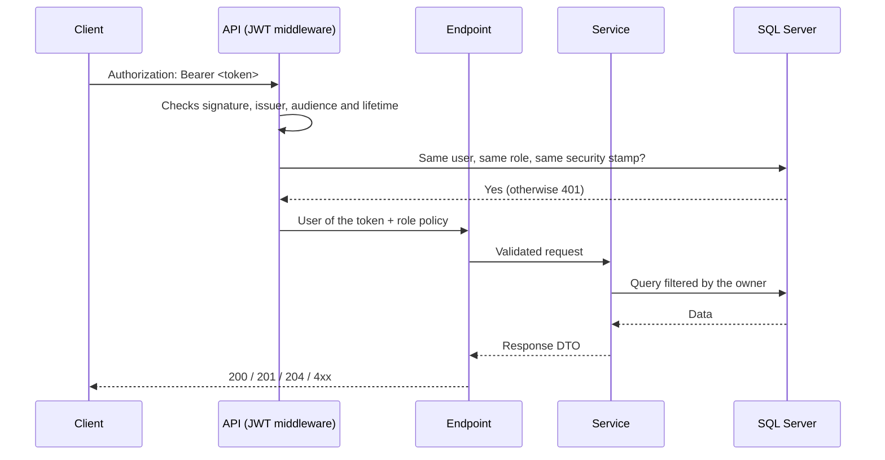

# Authdoc

**A user management API where each user owns and manages their own documents.**

Authdoc is an **ASP.NET Core 10** Minimal API with **JWT** authentication, roles and sessions, plus a **React + TypeScript** web app. Each user signs up, signs in and keeps a private list of their documents (type, number, issue date and expiry date). Admins manage the accounts, but they cannot see anyone's documents.

> **Each user accesses only their own documents.** This is the main rule of the project, and it has no exception.

It is a portfolio project, built to practice a complete and secure backend, a frontend that uses it, and a DevOps workflow on Azure DevOps.

## Features

**Users and access**

- Public sign-up, sign-in and sign-out, with JWT access tokens and refresh tokens (rotation and revocation)
- Password change that ends every session of the user at once
- Two roles: `User` and `Admin`. Admins list, edit, delete and promote users, and the last admin is always protected
- Rate limiting on sign-up, sign-in, password change, refresh and logout

**Documents**

- Add, list (with pagination), read, edit and delete your own documents
- Another user's document always answers `404`, so the API never reveals that it exists

**Web app**

- Sign-in, sign-up, my account, change password, and the pages to list, add, edit and delete documents
- The session survives a page reload and refreshes its token on its own

## Stack

| Layer | Technology |
|---|---|
| API | .NET 10, ASP.NET Core Minimal APIs |
| Data | Entity Framework Core 10 + SQL Server (code-first migrations) |
| Security | JWT Bearer, PBKDF2 password hashing (ASP.NET Core Identity) |
| Docs | OpenAPI + [Scalar](https://scalar.com) |
| Tests | xUnit, `WebApplicationFactory`, EF Core InMemory |
| Frontend | React 19, TypeScript, Vite, React Router |
| CI/CD | Azure Pipelines, Azure App Service |

## Architecture

```
├── Authdoc/                 # The API
│   ├── Program.cs           # Composition: DI, JWT, policies, rate limiting, startup
│   └── Src/
│       ├── Endpoints/       # HTTP routes and input validation
│       ├── Application/     # DTOs and services (business rules)
│       ├── Data/            # DbContext, migrations, first admin seed
│       ├── Models/Entities/ # User, Document, RefreshToken
│       ├── Responses/       # Error format and global exception handling
│       └── Validators/      # Email validation
├── Authdoc.Tests/           # Unit and integration tests
├── frontend/                # The web app
└── docs/                    # Detailed documentation
```

Each request goes through three layers: **endpoint** (HTTP only) → **service** (business rules) → **DbContext** (database).



## Getting started

You need the .NET 10 SDK, SQL Server and Node.js 20.19 or newer.

```bash
# 1. Secrets (once): a JWT key of 32+ bytes and the first admin password
cd Authdoc
dotnet user-secrets set "Jwt:Key" "<a-random-key-of-at-least-32-bytes>"
dotnet user-secrets set "SeedData:AdminPassword" "<a-strong-password>"
cd ..

# 2. API: applies the migrations and creates the first admin on startup
dotnet run --project Authdoc        # http://localhost:5297 (Scalar docs at /scalar)

# 3. Web app, in another terminal
cd frontend
npm install
npm run dev                         # http://localhost:5173

# 4. Tests
dotnet test
```

The first admin is `admin@system.com`, with the password from step 1. [Development](docs/development.md) explains how to generate the key, all the settings, the first admin and the CI/CD pipeline.

## API overview

| Area | Routes | Access |
|---|---|---|
| Auth | `POST /api/auth/register`, `login`, `refresh`, `logout`; `GET /api/auth/me`; `PUT /api/auth/password` | Public, except `me` and `password` |
| Users | `GET`, `PUT`, `DELETE /api/users/{id}`, `GET /api/users`, `PATCH /api/users/{id}/role` | Admin |
| Documents | `POST`, `GET /api/documents`, `GET`, `PUT`, `DELETE /api/documents/{id}` | Signed-in user, own documents only |

Every error has the same shape, with a stable code for the client:

```json
{ "code": "EMAIL_INVALID", "message": "Email is invalid" }
```

The full list of routes, rules and error codes is in the [API reference](docs/api.md).

## Security highlights

- Every request checks in the database that the user of the token still exists, with the same role and the same **security stamp**. So a deleted user, a changed role or a changed password blocks old tokens at once.
- Refresh tokens are stored only as hashes and work only once, even with two requests at the same time. A used token that comes back ends every session of the user, because it means someone has a copy.
- Every document query filters by the user id from the token, never from the request.
- Secrets live in User Secrets or environment variables, never in the repository.

The details and the known limitations are in [Security](docs/security.md).

## Roadmap

- [x] Users, roles, sessions and rate limiting
- [x] Documents with owner-only access
- [x] Web app version 1 (account, password and documents)
- [ ] Validity status of each document: `Valid`, `ExpiringSoon` (30 days or less) or `Expired`
- [ ] File upload (PDF, JPG, PNG, up to 10 MB)
- [x] Refresh token reuse detection
- [ ] Before the deploy: rate limiting behind the Azure proxy, email confirmation
- [ ] Production deploy on Azure, and the admin area in the web app
- [ ] Expiry notifications

## How I use AI in this project

I use AI agents during development, with fixed rules: branches, code and commits follow a standard I defined, I review every change before the merge, and I study the concepts behind each change, so I can explain every decision in this repository.

## Documentation

| Document | What is inside |
|---|---|
| [API reference](docs/api.md) | Routes, a first complete flow, business rules and error codes |
| [Development](docs/development.md) | Settings, secrets, first admin, database, tests and CI/CD |
| [Frontend](docs/frontend.md) | Pages, the API client, the session and the folder structure |
| [Security](docs/security.md) | How users and documents are protected, and the known limitations |
