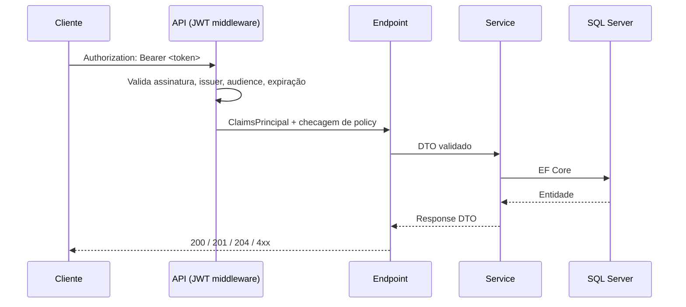
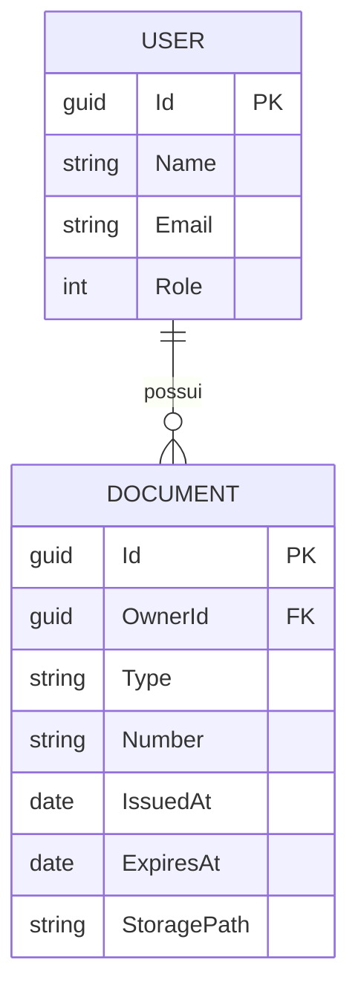

# Authdoc

**Um cofre pessoal de documentos: tudo organizado em um só lugar, para quando for pedido.**

Aplicação de **organização e armazenamento de documentos pessoais**. Hoje, o que existe é a base: uma API de identidade e controle de acesso construída em **ASP.NET Core 10 (Minimal APIs)**, com **JWT**, **Entity Framework Core** e **SQL Server**.

---

## O problema

Em agosto de 2026 fui ao meu atendimento de imigração em Portugal com todos os documentos da lista oficial publicada, todos válidos. No balcão, fui informado de que faltavam documentos que não constavam nessa lista.

Não dá para prever tudo o que pode ser pedido. O que dá para controlar é ter cada documento que eu possuo guardado, organizado e com o prazo de validade à vista. Foi daí que nasceu o Authdoc.

## Visão do produto

O Authdoc é um cofre pessoal: cada pessoa guarda os próprios documentos em um só lugar, organizados por tipo, e consegue encontrá-los na hora em que forem pedidos.

- **Organização:** cada documento com tipo, número, data de emissão e data de validade
- **Armazenamento privado:** upload e consulta restritos ao dono
- **Prazo à vista:** cada documento mostra um status calculado a partir da data de validade informada pelo próprio usuário: `Valid`, `ExpiringSoon` (vence em até 30 dias) ou `Expired`

A garantia central do projeto:

> **Cada usuário acessa exclusivamente os próprios documentos.**

Essa regra não tem exceção: o papel `Admin` gerencia contas, mas não dá acesso aos documentos de outros usuários.

Por isso o projeto começa pela camada de identidade. Autenticação, papéis (roles) e emissão de tokens são a base sobre a qual o módulo de documentos está sendo construído.

### O que o Authdoc não é

- **Não diz quais documentos um processo exige.** Ele guarda o que o usuário tem, e não o que uma entidade pode pedir.
- **Não valida documentos.** "Dentro do prazo" significa apenas que a data de validade informada ainda não passou. A aplicação não verifica autenticidade nem se o documento será aceito.
- **Não informa a situação legal de ninguém nem é aconselhamento jurídico.**
- **Não é um serviço em produção.** É um projeto de portfólio, sem ambiente público, e não deve receber documentos reais de terceiros.

## Status atual

| Módulo | Status |
|---|---|
| Autenticação (login, emissão de JWT) | ✅ Implementado |
| Sessão (refresh token com rotação e revogação) | ✅ Implementado |
| Troca de senha | ✅ Implementado |
| Autorização por papel (`Admin` / `User`) | ✅ Implementado |
| Gestão de usuários (CRUD administrativo e paginação) | ✅ Implementado |
| Rate limiting em login, troca de senha e refresh | ✅ Implementado |
| Tratamento global de exceções | ✅ Implementado |
| Bootstrap automático (migrations + admin inicial) | ✅ Implementado |
| Testes unitários e de integração | ✅ Implementado |
| Pipeline de CI (build e testes) | ✅ Implementado |
| Deploy automático no Azure App Service | ⏸️ Configurado, desligado até existir ambiente de produção |
| **Módulo de documentos** | 🚧 Em desenvolvimento |
| Vínculo documento ↔ usuário com autorização por propriedade | 🚧 Em desenvolvimento |
| Status de validade (`Valid` / `ExpiringSoon` / `Expired`) | 🚧 Em desenvolvimento |
| Notificação de vencimento (Workers + Outbox) | 📋 Planejado |
| Cadastro público (auto-registro) | 📋 Planejado |

Hoje o Authdoc é uma **API de identidade e gestão de usuários**. Nenhuma funcionalidade de documentos está disponível ainda: o módulo está em desenvolvimento e reutiliza toda a infraestrutura de autenticação já existente.

---

## Stack

| Camada | Tecnologia |
|---|---|
| Runtime | .NET 10 |
| Web | ASP.NET Core Minimal APIs |
| Persistência | Entity Framework Core 10 + SQL Server |
| Autenticação | JWT Bearer (`Microsoft.AspNetCore.Authentication.JwtBearer`) |
| Hash de senha | `IPasswordHasher<T>` do ASP.NET Core Identity (PBKDF2) |
| Documentação | OpenAPI + [Scalar](https://scalar.com) |
| Testes | xUnit + `WebApplicationFactory` + EF Core InMemory |
| CI/CD | Azure Pipelines + Azure App Service |

## Conceitos e fundamentos aplicados

- **Autenticação stateless com JWT:** o token é assinado com HMAC-SHA256 e carrega claims de identidade (`NameIdentifier`, `Name`, `Email`, `Role`). A API valida issuer, audience, tempo de vida e assinatura em cada requisição.
- **Refresh token com rotação:** cada uso gera um novo token e revoga o anterior. No banco fica apenas o hash SHA-256.
- **Autorização baseada em papéis (RBAC):** uma policy `Admin` protege as rotas administrativas.
- **Hash de senha com salt:** as senhas nunca são persistidas em texto puro. O `PasswordHasher` gera hashes PBKDF2 com salt aleatório e versionamento de formato, o que permite fazer rehash quando o algoritmo evolui.
- **Injeção de dependência e ciclo de vida de serviços:** services e `DbContext` são registrados como *Scoped* (um por requisição). No startup, um escopo explícito é criado para o bootstrap do banco.
- **Code-first com EF Core Migrations:** o schema é versionado em código e aplicado automaticamente na inicialização.
- **Separação em camadas:** endpoints (HTTP) → services (regras de negócio) → `DbContext` (persistência), com DTOs isolando o contrato da API do modelo de domínio.
- **Identificadores GUID:** evitam enumeração sequencial de recursos, algo relevante quando os recursos forem documentos pessoais.
- **Semântica HTTP:** `201 Created` com `Location`, `204 No Content` e `409 Conflict` para e-mail duplicado.

---

## Arquitetura

```
├── azure-pipelines.yml            # Pipeline de CI/CD
├── Authdoc/
│   ├── Program.cs                 # Composição: DI, JWT, policies, rate limiting, bootstrap, pipeline HTTP
│   └── Src/
│       ├── Endpoints/             # Mapeamento HTTP (Minimal API) e validação de entrada
│       ├── Application/
│       │   ├── DTOs/              # Contratos de request/response
│       │   └── Services/          # AuthService, UserService (regras de negócio)
│       ├── Data/
│       │   ├── ManagerDbContext.cs  # DbContext e configuração do modelo
│       │   ├── DbInitializer.cs     # Migrations + seed do admin inicial
│       │   └── Migrations/
│       ├── Models/Entities/       # Entidades de domínio (User, UserRole, RefreshToken)
│       ├── Responses/             # Formato de erro e tratamento global de exceções
│       └── Validators/            # Validação de e-mail
└── Authdoc.Tests/
    ├── Integration/               # API completa via HTTP
    └── *.cs                       # Testes unitários
```

Fluxo de uma requisição autenticada:



---

## Como executar

### Pré-requisitos

- [.NET SDK 10](https://dotnet.microsoft.com/download)
- SQL Server (a configuração padrão aponta para `localhost\SQLEXPRESS` com autenticação integrada do Windows)
- Opcional: `dotnet tool install --global dotnet-ef`, para gerenciar migrations

### Configuração

As configurações não sensíveis ficam em `Authdoc/appsettings.json`:

```json
{
  "ConnectionStrings": {
    "DefaultConnection": "Server=localhost\\SQLEXPRESS;Database=Authdoc;Trusted_Connection=True;TrustServerCertificate=True;"
  },
  "Jwt": {
    "Issuer": "Authdoc",
    "Audience": "Users",
    "ExpirationInMinutes": 60,
    "RefreshTokenExpirationInDays": 7
  },
  "RateLimiting": {
    "LoginPermitLimit": 5,
    "RefreshPermitLimit": 30
  }
}
```

Em desenvolvimento, os segredos vêm dos User Secrets. Fora de desenvolvimento, a API precisa destas variáveis de ambiente:

| Configuração | Variável de ambiente | Obrigatória |
|---|---|---|
| Chave de assinatura do JWT | `Jwt__Key` | Sempre |
| Senha do admin inicial | `SeedData__AdminPassword` | Enquanto o admin inicial não existir |
| Connection string do banco | `ConnectionStrings__DefaultConnection` | Sempre, pois o valor padrão só serve para a máquina local |

### Chave de assinatura do JWT

A chave de assinatura é um segredo, por isso **não** fica no `appsettings.json`. A API lê o valor de `Jwt:Key`, que precisa ter pelo menos 32 bytes (HS256); com menos que isso, ela não inicia. Gere uma chave aleatória uma vez e guarde nos [User Secrets](https://learn.microsoft.com/aspnet/core/security/app-secrets), que ficam fora do repositório:

```powershell
cd Authdoc

# PowerShell
$bytes = New-Object byte[] 64
[System.Security.Cryptography.RandomNumberGenerator]::Create().GetBytes($bytes)
dotnet user-secrets set "Jwt:Key" ([Convert]::ToBase64String($bytes))
```

```bash
# Bash
dotnet user-secrets set "Jwt:Key" "$(openssl rand -base64 64 | tr -d '\n')"
```

### Senha do admin inicial

A senha do admin inicial também é um segredo. Escolha uma senha forte e guarde em `SeedData:AdminPassword`:

```powershell
cd Authdoc
dotnet user-secrets set "SeedData:AdminPassword" "<sua-senha-forte>"
```

Ela só é necessária quando o admin inicial é criado (veja [Bootstrap](#bootstrap-o-primeiro-usuário)). Se o admin ainda não existir e a configuração estiver ausente, a API falha na inicialização.

### Subindo a API

```bash
git clone <url-do-repositorio>
cd Authdoc
dotnet run --project Authdoc
```

- API: `http://localhost:5297`
- Documentação interativa (Scalar, apenas em `Development`): `http://localhost:5297/scalar`

### Rodando os testes

```bash
dotnet test
```

| Tipo | O que cobre |
|---|---|
| Unitários | `EmailValidator` e as regras do `UserService` (último admin, exclusão, troca de papel) |
| Integração | A API inteira via HTTP com `WebApplicationFactory`: autenticação, refresh token, troca de senha, usuários, paginação, rate limiting e códigos de erro |

Os testes usam um banco **em memória** e configuração própria, então não precisam de SQL Server nem de User Secrets.

---

## CI/CD

A pipeline fica em `azure-pipelines.yml` e roda a cada alteração na branch `main`:

1. Restaura as dependências
2. Compila em `Release`
3. Executa os testes; se algum falhar, o deploy não acontece
4. Publica a API e gera o artefato `drop`
5. Faz o deploy no Azure App Service, apenas na `main` e com a variável `deployEnabled` em `'true'`

O deploy está desligado (`deployEnabled: 'false'`) até o banco e as configurações de produção existirem. As demais etapas continuam rodando.

---

## Como uso IA no projeto

Uso agentes de IA no desenvolvimento, com regras fixas:

- Branches, código e commits seguem um padrão definido por mim, aplicado por skills e subagentes dedicados a tarefas específicas
- Toda mudança é revisada por mim antes do merge
- Uso a IA também para estudar os conceitos por trás do que foi gerado: o objetivo é conseguir explicar cada decisão descrita neste README

---

## Bootstrap: o primeiro usuário

O cadastro de usuários é uma operação **administrativa**: o endpoint de registro exige a policy `Admin`. Isso cria um problema clássico de "ovo e galinha": sem um admin, ninguém consegue cadastrar ninguém.

O `DbInitializer` resolve isso na inicialização da aplicação:

1. **Aplica as migrations pendentes** (`Database.MigrateAsync()`). O banco é criado se ainda não existir.
2. **Verifica se já existe algum usuário com papel `Admin`.** Se existir, não faz nada. A operação é idempotente e segura para rodar a cada startup.
3. **Se existe um usuário com o e-mail do admin padrão, mas sem o papel**, promove esse usuário a `Admin`.
4. **Caso contrário, cria o admin inicial**, com a senha passando pelo mesmo `IPasswordHasher` usado no fluxo de registro e login.

Credenciais iniciais:

| E-mail | Senha |
|---|---|
| `admin@system.com` | O valor configurado em `SeedData:AdminPassword` (veja [Senha do admin inicial](#senha-do-admin-inicial)) |

### Primeiro fluxo completo

```http
### 1. Login como admin
POST http://localhost:5297/api/auth/login
Content-Type: application/json

{ "email": "admin@system.com", "password": "<SeedData:AdminPassword>" }

### 2. Cadastrar um usuário (use o token retornado no passo 1)
POST http://localhost:5297/api/auth/register
Authorization: Bearer <token>
Content-Type: application/json

{
  "name": "Maria Silva",
  "email": "maria@gmail.com",
  "password": "senha123",
  "confirmationPassword": "senha123"
}

### 3. Login com o novo usuário
POST http://localhost:5297/api/auth/login
Content-Type: application/json

{ "email": "maria@gmail.com", "password": "senha123" }
```

---

## Endpoints

### Auth

| Método | Rota | Acesso | Descrição |
|---|---|---|---|
| `POST` | `/api/auth/login` | Público | Autentica e retorna JWT, refresh token, expirações e dados do usuário |
| `POST` | `/api/auth/refresh` | Público | Troca um refresh token válido por um novo par de tokens |
| `PUT` | `/api/auth/password` | Autenticado | Troca a própria senha (encerra as outras sessões) |
| `POST` | `/api/auth/register` | Admin | Cadastra um novo usuário |
| `GET` | `/api/auth/me` | Autenticado | Retorna a identidade contida no token, incluindo o papel |

### Users

| Método | Rota | Acesso | Descrição |
|---|---|---|---|
| `GET` | `/api/users?page=1&pageSize=10` | Admin | Lista usuários com paginação (`pageSize` de 1 a 100) |
| `GET` | `/api/users/{id}` | Admin | Consulta um usuário |
| `PUT` | `/api/users/{id}` | Admin | Atualiza nome e e-mail |
| `PATCH` | `/api/users/{id}/role` | Admin | Altera o papel do usuário (`Admin` ou `User`) |
| `DELETE` | `/api/users/{id}` | Admin | Remove um usuário |

### Regras de negócio

- E-mail válido, de qualquer domínio e único na base, validado no cadastro e na atualização
- E-mail normalizado (sem espaços nas pontas e em minúsculas) antes de validar, buscar ou salvar
- Nome obrigatório, com no máximo 100 caracteres
- Senha com no mínimo 8 caracteres, sem ser só espaços, confirmada no cadastro
- Login e troca de senha limitados a 5 tentativas por minuto por IP, e refresh a 30; acima disso a API responde `429`
- O refresh token vale 7 dias, só pode ser usado uma vez (cada uso gera um novo) e é guardado apenas como hash SHA-256
- Trocar a senha revoga todos os refresh tokens do usuário
- Papel (`Role`) não é alterável pelo endpoint de atualização, o que evita escalonamento de privilégio via payload
- Papel alterado apenas por `PATCH /api/users/{id}/role`, com corpo `{ "role": "Admin" }` ou `{ "role": "User" }`
- Uma mudança de papel passa a valer no próximo refresh ou login, pois o papel fica gravado no JWT
- Um admin não pode alterar o próprio papel, e o último admin do sistema não pode ser rebaixado
- Um admin não pode excluir o próprio usuário, e o último admin do sistema não pode ser excluído
- Exceções inesperadas são interceptadas e registradas de forma centralizada pelo `IExceptionHandler`, sem expor detalhes internos ao cliente

### Formato de erro

As respostas de erro da API têm o mesmo formato, com um `code` estável (para o cliente tratar) e uma `message` legível:

```json
{ "code": "EMAIL_INVALID", "message": "Email is invalid" }
```

| Status | Códigos |
|---|---|
| `400` | `INVALID_REQUEST`, `NAME_REQUIRED`, `NAME_TOO_LONG`, `EMAIL_REQUIRED`, `EMAIL_INVALID`, `PASSWORD_REQUIRED`, `PASSWORD_TOO_SHORT`, `PASSWORDS_DO_NOT_MATCH`, `ROLE_INVALID`, `CANNOT_CHANGE_OWN_ROLE`, `CANNOT_DELETE_OWN_USER`, `CURRENT_PASSWORD_REQUIRED`, `CURRENT_PASSWORD_INCORRECT`, `NEW_PASSWORD_SAME_AS_CURRENT`, `REFRESH_TOKEN_REQUIRED`, `PAGE_INVALID`, `PAGE_SIZE_INVALID` |
| `401` | `INVALID_CREDENTIALS`, `INVALID_REFRESH_TOKEN`, `UNAUTHORIZED` |
| `403` | `FORBIDDEN` |
| `404` | `USER_NOT_FOUND` |
| `409` | `EMAIL_ALREADY_IN_USE`, `LAST_ADMIN` |
| `429` | `TOO_MANY_REQUESTS` |
| `500` | `INTERNAL_ERROR` |

Os códigos ficam centralizados em `Src/Responses/ApiErrors.cs`.

---

## Roadmap

### Em desenvolvimento: módulo de documentos

O objetivo é associar cada documento ao seu dono no banco e aplicar **autorização baseada em recurso**: além de estar autenticado, o usuário só lê, altera ou remove documentos que lhe pertencem.



- Entidade `Document` com chave estrangeira `OwnerId → User.Id`
- O `OwnerId` sempre vem da claim `NameIdentifier` do token, nunca do corpo da requisição
- Consultas filtradas pelo dono (`WHERE OwnerId = @currentUser`), com `404` para documentos de terceiros, sem revelar a existência deles
- O papel `Admin` não dá acesso a documentos de outros usuários
- Armazenamento de arquivos atrás de uma interface, com uma implementação em disco local, para a API não depender do local físico
- Upload restrito a PDF, JPG e PNG, com no máximo 10 MB
- Status de validade calculado a partir de `ExpiresAt`: `Valid`, `ExpiringSoon` (vence em até 30 dias) ou `Expired`

Critérios de pronto do módulo:

1. Enviar um documento (arquivo, tipo, número e datas de emissão e validade)
2. Listar e consultar somente os próprios documentos
3. Acessar, alterar ou remover documento de outro usuário retorna `404`
4. Cada documento retornado traz o status de validade
5. Testes de integração para os pontos 2 e 3 e testes unitários para a regra de status

### Depois

- **Cadastro público:** hoje o registro é uma operação administrativa (veja [Bootstrap](#bootstrap-o-primeiro-usuário)), então uma pessoa ainda não consegue criar a própria conta
- **Notificação de vencimento:** avisar o usuário de forma ativa, com Workers e Outbox. Nesta etapa o prazo aparece apenas como status na consulta

### Questão em aberto

Ponto que precisa de decisão antes de qualquer uso real:

| Questão | Por que importa |
|---|---|
| Dados pessoais sensíveis (RGPD) | Passaportes e títulos de residência exigem cifragem em repouso, política de retenção e eliminação a pedido do titular |

### Evolução da base

- [ ] Autorização por recurso (`IAuthorizationHandler`) para documentos
- [ ] Validação centralizada (FluentValidation)
- [ ] Docker Compose (API + SQL Server)
- [x] Pipeline de build e testes (deploy configurado, desligado)
- [x] Índice único de e-mail e limites de tamanho em `Email` e `Name`
- [x] Tratamento global de exceções
- [x] Refresh token e revogação de sessão
- [x] Rate limiting no login
- [x] Listagem paginada de usuários
- [x] Segredos via User Secrets / variáveis de ambiente
- [x] Testes unitários e de integração (xUnit + `WebApplicationFactory`)

---

## Segurança

A chave JWT e a senha do admin inicial não são versionadas: em desenvolvimento elas vêm dos User Secrets e, nos demais ambientes, de variáveis de ambiente (veja [Configuração](#configuração)). Em qualquer ambiente real, a senha do admin deve ser trocada no primeiro acesso.

### Limitações conhecidas

| Limitação | Impacto | Possível solução |
|---|---|---|
| O JWT continua válido até expirar | Um usuário rebaixado ou excluído mantém o acesso antigo por até `Jwt:ExpirationInMinutes`. O refresh já devolve o papel novo, mas o token antigo segue válido até vencer | Reduzir `Jwt:ExpirationInMinutes` (o refresh evita logins repetidos) ou verificar um *security stamp* a cada requisição |
| A regra do último admin não é atômica | Duas requisições simultâneas podem rebaixar ou excluir os dois últimos admins | Transação com isolamento adequado ou trava no banco |
| O rate limiting fica na memória e é por IP | Zera quando a API reinicia, não é compartilhado entre instâncias e, atrás de um proxy, todos podem parecer o mesmo IP | Rate limiting distribuído (ex.: Redis) e configurar `ForwardedHeaders` |
| Os testes de integração usam banco em memória | O índice único de e-mail não é verificado pelo banco nos testes | Testes com SQL Server real (ex.: Testcontainers) |
